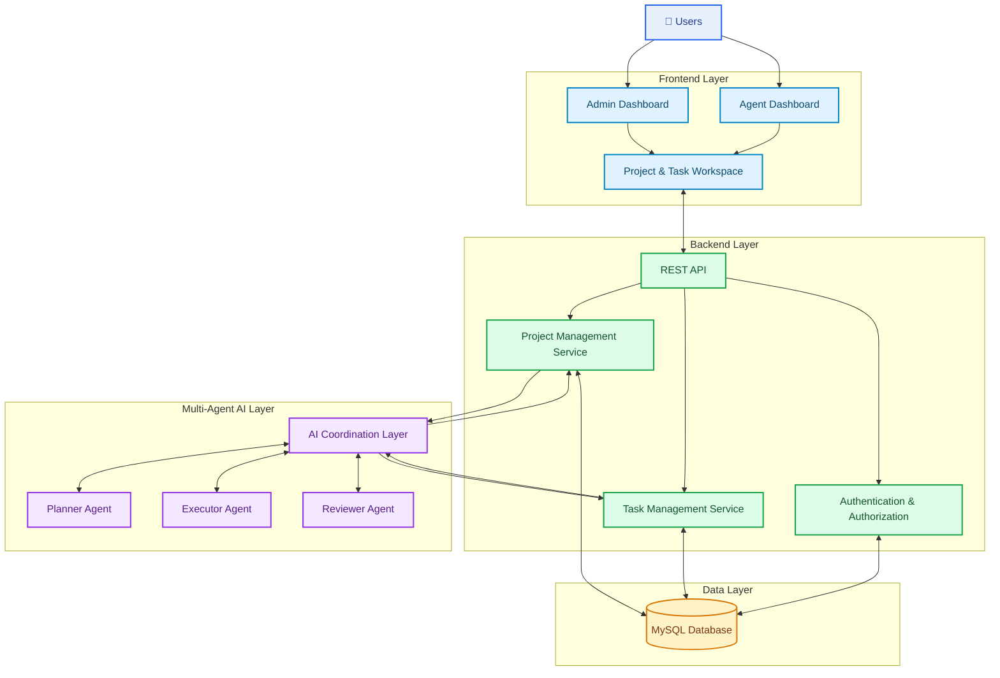
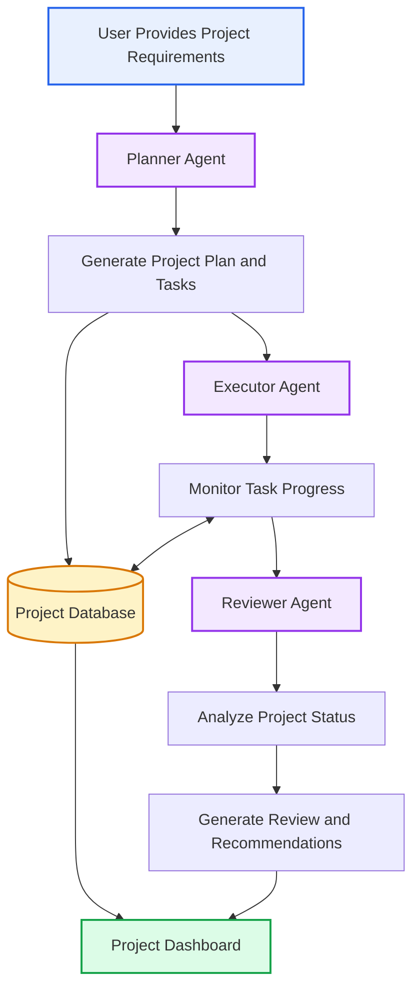

# 🤖 AI Multi-Agent Project Manager

**An AI-powered platform for intelligent project planning, task management, and team collaboration.**

The AI Multi-Agent Project Manager is a web-based application designed to simplify project planning, task allocation, progress monitoring, and team coordination. It combines a centralized project management interface with a multi-agent AI architecture to support intelligent planning, execution monitoring, and project review.

---

## 📌 Overview

Project teams often spend considerable time creating tasks, assigning responsibilities, tracking progress, and reviewing project status. Manual coordination can make it difficult to identify delays, prioritize work, and maintain visibility across multiple projects.

The AI Multi-Agent Project Manager provides a centralized workspace where administrators can manage projects and tasks while agents access their assigned work and update progress.

The application is designed around three specialized AI agents:

- **Planner Agent:** Supports project planning and task organization.
- **Executor Agent:** Supports task execution and progress monitoring.
- **Reviewer Agent:** Supports project analysis and review.

Together, these components aim to improve project coordination, reduce repetitive work, and support informed decision-making.

## ✨ Key Features

### 🔐 Role-Based Access
- Separate Admin and Agent dashboards.
- Role-specific application access.
- Dedicated interfaces for project management and task execution.

### 📁 Project Management
- Create new projects.
- Add project titles, descriptions, dates, and statuses.
- View project details.
- Edit existing projects.
- Delete projects when appropriate.

### 📋 Task Management
- Create tasks within projects.
- Assign tasks to team members.
- Set task priorities.
- Track task status.
- Organize tasks by project.

### 👨‍💼 Admin Dashboard
- View and manage projects.
- Create and organize tasks.
- Review project information.
- Access project-level task details.

### 👩‍💻 Agent Dashboard
- View assigned tasks.
- Access project workspaces.
- Monitor individual task progress.
- Update task statuses according to assigned permissions.

### 🤖 Multi-Agent AI Architecture

The application uses a multi-agent design to separate project management responsibilities into specialized components.

| Agent | Responsibility |
|---|---|
| Planner Agent | Project planning and task organization |
| Executor Agent | Task execution and progress-related workflows |
| Reviewer Agent | Project review, analysis, and recommendations |

The actual AI capabilities depend on the corresponding agent workflows and integrations implemented in the application.

### 📊 Progress Monitoring
- View pending tasks.
- Track in-progress tasks.
- Identify completed tasks.
- Review project-level progress summaries.

### 🔌 Backend API Integration
- Connect the frontend with backend services.
- Exchange project and task information.
- Support project management operations through API endpoints.

---

## 🏗️ System Architecture

The following diagram illustrates the logical architecture of the application.



### Architecture Components

**1. Frontend Layer**

Provides the user interface for administrators and agents. It includes dashboards, project views, task management forms, and project workspaces.

**2. Backend Layer**

Processes application requests, manages project and task operations, and provides REST API endpoints to the frontend.

**3. Multi-Agent AI Layer**

Separates AI-related responsibilities into planning, execution, and review workflows. An AI coordination layer can manage how these agents interact with application services.

**4. Database Layer**

MySQL stores project information, task details, user records, and other application data defined by the database schema.

*Note: This is a logical architecture diagram. Confirm that all illustrated components and connections exist in your implementation before presenting it as the deployed architecture.*

---

## 🔄 Multi-Agent Workflow



### Agent Responsibilities

**Planner Agent**
- Supports project requirement analysis.
- Organizes project work into tasks.
- Helps structure task priorities and dependencies where implemented.

**Executor Agent**
- Supports task execution workflows.
- Tracks task-related information.
- Helps monitor progress where connected to the application.

**Reviewer Agent**
- Reviews available project information.
- Identifies potential issues when supported by the implemented logic.
- Provides project summaries and recommendations where implemented.

---

## 🛠️ Technology Stack

| Component | Technology |
|---|---|
| Frontend | React |
| Styling | Tailwind CSS |
| Backend | Node.js |
| Backend Framework | Express.js |
| Database | MySQL |
| HTTP Client | Axios |
| API Architecture | REST API |
| Version Control | Git and GitHub |
| AI Architecture | Multi-agent AI |

*Add the exact LLM provider, model, AI libraries, or orchestration framework used by your project after verifying the dependencies and source code.*

---

## 📂 Project Structure

The following is an example structure. Update it to match your actual repository.

```text
AI-MultiAgent-Project-Manager/
│
├── frontend/
│   ├── public/
│   ├── src/
│   │   ├── components/
│   │   ├── pages/
│   │   ├── services/
│   │   ├── App.jsx
│   │   └── main.jsx
│   ├── package.json
│   └── index.html
│
├── backend/
│   ├── routes/
│   ├── controllers/
│   ├── models/
│   ├── services/
│   ├── config/
│   ├── middleware/
│   ├── server.js
│   └── package.json
│
├── ai-agents/
│   ├── planner-agent/
│   ├── executor-agent/
│   └── reviewer-agent/
│
├── database/
│   └── schema.sql
│
├── .env.example
├── .gitignore
└── README.md
```

**Note:** Keep only the directories and files that actually exist in your repository.

---

## ⚙️ Getting Started

### Prerequisites

Install the following:

- Node.js
- npm
- MySQL Server
- Git
- Visual Studio Code or another code editor

### 1. Clone the Repository

Replace the example URL with your actual GitHub repository URL.

```bash
git clone https://github.com/YOUR_USERNAME/AI-MultiAgent-Project-Manager.git
cd AI-MultiAgent-Project-Manager
```

### 2. Install Frontend Dependencies

```bash
cd frontend
npm install
```

Start the frontend using the script configured in `frontend/package.json`.

For example:

```bash
npm run dev
```

Open the local URL displayed in the terminal.

### 3. Install Backend Dependencies

Open another terminal from the project root.

```bash
cd backend
npm install
```

### 4. Configure Environment Variables

Create a `.env` file in the backend directory if required by your application.

Example configuration:

```env
PORT=5000
DB_HOST=localhost
DB_USER=your_mysql_username
DB_PASSWORD=your_mysql_password
DB_NAME=ai_project_manager
```

Use the variable names expected by your backend code. Do not commit credentials or API keys.

### 5. Configure the Database

Start MySQL and create the database if it does not already exist.

```sql
CREATE DATABASE ai_project_manager;
```

Run the database schema or migration procedure included in your repository.

Update the database configuration to use your actual database credentials.

### 6. Configure AI Services

If the application uses an external LLM provider, configure its API credentials and model settings in the backend environment.

Do not expose secret API keys in frontend code or commit them to GitHub.

### 7. Start the Backend

Use the start command defined in the backend's `package.json`.

For example:

```bash
npm start
```

Or, if a development script is configured:

```bash
npm run dev
```

The backend URL depends on the port configured by your application.

### 8. Run the Application

Verify that:

- MySQL is running.
- Database configuration is correct.
- Backend APIs are available.
- Frontend API configuration points to the backend.
- Required AI services are configured.

Then open the frontend and sign in using an account configured for the application.

*The commands above are typical examples. Follow your actual repository configuration if its folder structure or scripts differ.*

---

## 📊 Task Status Management

Tasks can be categorized by their progress.

| Status | Description |
|---|---|
| Pending | Work has not started. |
| In Progress | Work is currently underway. |
| Completed | Work has been completed. |

Task priority helps teams organize work according to its importance.

---

## 🔐 Security Considerations

- Store passwords using a secure password-hashing method.
- Validate user input on the backend.
- Use parameterized SQL queries or a suitable ORM.
- Enforce authorization on protected backend routes.
- Store credentials in environment variables.
- Restrict access to project and task operations.
- Avoid committing sensitive configuration files to version control.

Verify these controls in the actual application before claiming that each one is implemented.

---

## 🧪 Testing

Test the main application workflows before deployment:

- Authentication and role-based access.
- Project creation and editing.
- Task creation and assignment.
- Task status updates.
- Database persistence.
- REST API communication.
- AI agent workflows.
- Error handling and invalid inputs.
- Dashboard data consistency.

Run the test commands configured in your frontend and backend `package.json` files.

---

## 🚀 Future Enhancements

Potential improvements include:

- Advanced AI task prioritization.
- Project delay prediction.
- Team workload optimization.
- Project risk analysis.
- Natural-language project queries.
- Automated project summaries.
- Retrieval-Augmented Generation (RAG) for project documentation.
- Model Context Protocol (MCP) integrations for AI tool usage.
- Enhanced reporting and analytics.
- Improved scalability and deployment.

These are possible extensions and should not be presented as completed features unless they are implemented.

---

## 👩‍💻 Author

**Rithi R**

B.Tech. — Artificial Intelligence and Data Science  
KPR Institute of Engineering and Technology  
Coimbatore, Tamil Nadu, India

- **GitHub:** [Rithirajendran](https://github.com/Rithirajendran)
- **LinkedIn:** [Rithi R](https://www.linkedin.com/in/rithi-r-011264380)
- **Portfolio:** [Personal Portfolio](https://rithirajendran.github.io/portfolio/)

---

## 📄 License

Add an appropriate open-source license if you intend to distribute this project publicly.

Until a license is added, reuse and redistribution permissions may be limited.

---

**AI Multi-Agent Project Manager — Bringing intelligent planning, task coordination, and project review into one collaborative workspace.**
